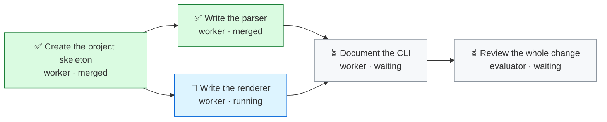

> ⚠️ _SYNTHETIC: a mid-flight iteration made up to test the graph. Real records have one task._

# 🔵 Iteration 17 — goal not reached

**Running** · 2/5 tasks merged · 15m 06s · 4.2k tokens out · cache hit 81%

<b>Roles and tools</b>

| Role | Model | Effort | Tools |
|---|---|---|---|
| worker | haiku-5-5 | low | Read, Grep, Glob, Write, Edit, Skill, Bash (git, python3, echo, printf, mkdir) |
| policymaker | haiku-5-5 | low | Read, Grep, Glob, Write, Edit |

<b>Sessions (3)</b> · tokens: in 18 · out 4.2k · cache read 108.9k (81%) · cache write 25.6k

- ✅ **worker** · Create the project skeleton · haiku-5-5/low · 10 turns · 38s · in 8 · out 2.8k · cache read 52.5k (76%) · cache write 16.1k
- ✅ **worker** · Write the parser · haiku-5-5/low · 10 turns · 38s · in 8 · out 2.8k · cache read 52.5k (76%) · cache write 16.1k
- 🔄 **worker** · Write the renderer · haiku-5-5/low · 10 turns · 38s · in 8 · out 2.8k · cache read 52.5k (76%) · cache write 16.1k

<b>Policy changes (0)</b>

_none this iteration_

Updated by the engine at 2026-11-02 19:25 UTC
