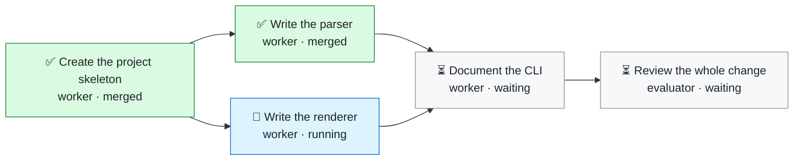

> ⚠️ _SYNTHETIC: a mid-flight iteration made up to test the graph. Real records have one task._

## 🔵 Iteration 17 · running · goal not reached

Started 2026-11-02 19:10 UTC · took 15m 06s · engine 0.7.0

### Active roles
| Role | Model | Effort | Sessions | In | Out | Cache read | Cache write |
|---|---|---|---|---|---|---|---|
| worker | haiku-5-5 | low | 3 | 24 | 8.4k | 157.6k (76%) | 48.4k |
| policymaker | haiku-5-5 | low | – | – | – | – | – |

### Task graph

### Policy changes
_none this iteration_

### Tokens and cache
| | in | out | cache read | cache write |
|---|---|---|---|---|
| This iteration | 18 | 4.2k | 108.9k | 25.6k |
| Last 9 iterations | 152 | 33.0k | 1024.1k | 158.9k |

### Session summaries
- worker (synthetic)
- worker (synthetic)
- worker (synthetic)

Updated by the engine at 2026-11-02 19:25 UTC
