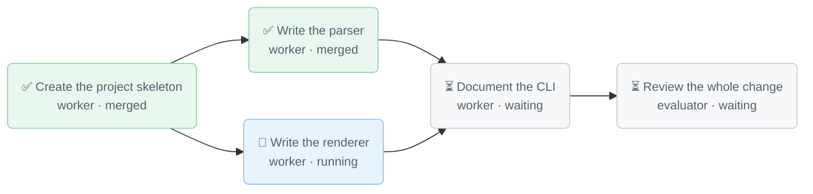

> ⚠️ _SYNTHETIC: a mid-flight iteration made up to test the graph. Real records have one task._

## 🔵 Iteration 17 · running · goal not reached

Started 2026-11-02 19:10 UTC · took 15m 06s · engine 0.7.0

### Active roles
| Role | Model | Effort | In | Out | Cache read | Cache write |
|---|---|---|---|---|---|---|
| worker #1 | haiku-5-5 | low | 8 | 2.8k | 52.5k (76%) | 16.1k |
| worker #2 | haiku-5-5 | low | 8 | 2.8k | 52.5k (76%) | 16.1k |
| worker #3 | haiku-5-5 | low | 8 | 2.8k | 52.5k (76%) | 16.1k |
| policymaker | haiku-5-5 | low | – | – | – | – |

### Task graph

### Policy changes
_none this iteration_

### Session summaries
- worker (synthetic)
- worker (synthetic)
- worker (synthetic)

Updated by the engine at 2026-11-02 19:25 UTC
